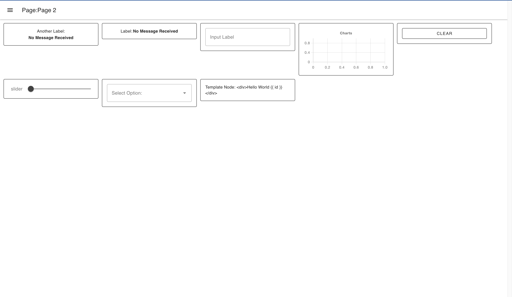

# Layout: Fest

Jede "Einheit" hat eine feste Breite, was das einzige verfügbare Layout im Dashboard 1.0 war.

Es ist als Flexbox-Layout aufgebaut, mit einer einzigen Reihe von Widgets. Die Breite jeder Gruppe ist eine feste Pixelgröße, berechnet als die "Breite"-Eigenschaft einer Gruppe, multipliziert mit der doppelten Zeilenhöhe (96px bei der Standardzeilenhöhe von 48px).

Die Gruppen selbst folgen demselben Muster wie alle anderen Layouts, wobei eine Gruppe mit der Breite "6" 6 "Spalten" hätte, mit entsprechend dimensionierten Widgets, sodass ein Widget der Größe "3 x 1" 50% der Gruppenbreite einnehmen würde.

Es verschiebt Widgets automatisch in die nächste Zeile, wenn sie nicht innerhalb einer gegebenen Bildschirmbreite passen, und ändert die Größe nicht mit der Bildschirmgröße, was oft viel leeren Bildschirmplatz hinterlässt. Die Höhe jeder Zeile wird durch das höchste Widget in dieser Zeile bestimmt.

{data-zoomable}
*Ein Beispiel für eine Benutzeroberfläche, die mit dem "Fest"-Layout gerendert wurde*

## Breakpoints

Unterhalb von 576px werden feste Layouts in einem responsiven Modus gerendert, um die mobile Darstellung zu unterstützen. Hier werden sie tatsächlich zu [Raster](./grid.md)-Layouts, wobei die Breite jeder Gruppe als Teil von 3 Spalten berechnet wird, anstatt einer festen Pixelgröße.